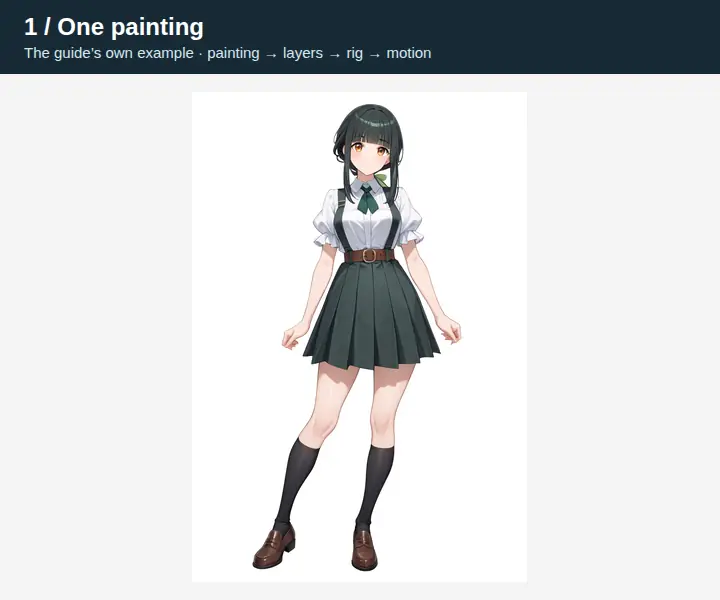
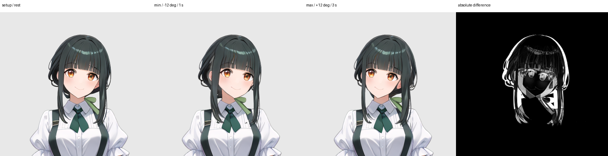

# Getting started with rig-c

You start with one painting of a character. You end with that character rigged — split
into movable pieces on a skeleton — breathing, blinking and waving in your browser.



Under-eight-second looping WebP, from this walkthrough's outputs.
[Rebuild it](docs/demo/README.md). Example artwork: CC BY-NC 4.0; credit below.

## The whole thing in one glance

1. **Paint one character.** An image model does this. It wants a GPU, but any image
   generator you already use will do.
2. **Split it into layers, and mark the joints.** [See-through](https://github.com/shitagaki-lab/see-through)
   is a model that cuts a painting into layers (hair, face, eyes, clothes…) the way a PSD is
   layered. It wants a GPU too, or you use its free web demo. The joints — shoulders,
   elbows, knees and so on — come from a small script on the CPU, or your own hand.
3. **Run the four rig-c packages.** They turn the layers into a rig, give it a motion, and
   play it in a browser. **No GPU, ever.**

Only steps 1 and 2 want a GPU, and both have a no-GPU way. The four packages make neither
the painting nor the layers, and ship no model weights.

*Try it first* has been run on an Apple Silicon Mac and, for the latest published-package
refresh, on Linux with empty caches and the joint detector. The versions, setup, date and
timings are in [docs/REFERENCE.md](docs/REFERENCE.md) — if an output of yours differs in a
detail, look there first.

**Contents:** [Try it first](#try-it-first--no-gpu-about-3-minutes) ·
[Use what you made](#use-what-you-made) ·
[Make your own character](#make-your-own-character) ·
[Troubleshooting](#troubleshooting) · [Where to go next](#where-to-go-next) ·
[Credits and licences](#credits-and-licences)

## Try it first — no GPU, about 3 minutes

This builds a published example character and plays it. Its painting and layers are
already made, so you skip the GPU steps entirely.

**You'll need:** [Bun](https://bun.sh) 1.4.0 or later (`bun --version` prints it), and
[uv](https://docs.astral.sh/uv/) for the one Python script in step 6 — or skip the script;
step 6 says how. About 3 minutes of commands, plus the first-time downloads, under 1 GB in
all. The commands are for a macOS or Linux terminal; Windows isn't tested yet.

### 1. Install the packages

```sh
mkdir rig-c-start
cd rig-c-start
git clone https://github.com/rig-c/getting-started
mkdir my-rig
cd my-rig
bun add @rig-c/parts @rig-c/core @rig-c/pose @rig-c/play
```

The See-through commands below read `config.seethrough`, which needs
`@rig-c/parts` 1.82.1 or newer; this also covers step 7's `extend_painting` fields
`order` and `min_held_alpha`. Bun writes the exact installed versions to
`package.json` and `bun.lock` in `my-rig`; keep both files to reproduce the install.

Every command from here on runs in `my-rig`. `bun run rigc --version` prints the version and
then `@esotericsoftware/spine-core absent`. That line is expected: the installed `rigc`
checks every build with its own validator.

### 2. Get the example inputs

```sh
curl -L -o exam.tar.gz https://codeload.github.com/rig-c/exam/tar.gz/01436ee3f02c189fe1a1e9656fe62068889837f5
tar -xzf exam.tar.gz --strip-components=3 exam-01436ee3f02c189fe1a1e9656fe62068889837f5/tasks/01-build/inputs
tar -xzf exam.tar.gz --strip-components=1 exam-01436ee3f02c189fe1a1e9656fe62068889837f5/LICENSE exam-01436ee3f02c189fe1a1e9656fe62068889837f5/NOTICE.md
rm exam.tar.gz
```

You should now have `inputs/` with `painting.png`, `layers/full/`, `layers/head/`,
`seethrough.json` and `generation.json`. The example is from
[rig-c/exam](https://github.com/rig-c/exam); its licence is under [Credits](#credits-and-licences).

### 3. Start the config

```sh
cat > config.json <<'EOF'
{
  "key": "exam-01",
  "seethrough": { "resolution": 1024, "steps": 30, "seed": 42, "offload": false },
  "assemble": { "rig_scale": 0.5 }
}
EOF
bunx rig-parts inputs --source inputs/painting.png --config config.json --out work
```

`config.json` is the one file the tools read about this character; it starts small and
fills in as you go. `rig_scale` 0.5 makes the rig half the painting's size.

You should see `st_input_full.png 2432x2432` and a note that there is no head box yet. With
your own painting, that square is what you feed See-through; here the layers are already in
`inputs/layers/full`.

### 4. Find the head box

The eyes are too small in the full-figure layers, so See-through runs a second time on a
crop around the head. This finds the crop.

```sh
bunx rig-parts layers inputs/layers/full
bunx rig-parts propose --head-box --full inputs/layers/full --canvas 1664x2432 | tail -n 1 > work/head_box.json
bun ../getting-started/scripts/take.ts work/head_box.json config.json seethrough.head_box=head_box
bunx rig-parts inputs --source inputs/painting.png --config config.json --out work
```

`--canvas` is the painting's width x height. [`scripts/take.ts`](scripts/take.ts) copies
fields the tools wrote into `config.json`, so you never move JSON by hand.

You should see `29 layer(s): 29 with opaque pixels` and `0 WARN line(s)`,
`work/head_box.json` reading `{"head_box":[616,32,1132,548]}`, then `st_input_head.png 516x516`
— the image for the head run, which here is already in `inputs/layers/head`.

### 5. Assemble the parts

```sh
bunx rig-parts assemble --propose-plan --source inputs/painting.png --full inputs/layers/full --head inputs/layers/head --config config.json > work/plan.json
bun ../getting-started/scripts/take.ts work/plan.json config.json assemble.plan=plan assemble.extend_below_crop=extend_below_crop
bunx rig-parts assemble --source inputs/painting.png --full inputs/layers/full --head inputs/layers/head --config config.json --out work
```

The plan says which layer becomes which part, and its `notes` say why any were left out.
About a minute.

You should see 22 parts, then `recomposite vs source: mean |d|=1.13, within 8: 97.8%`.
Open `work/render/recomposite_error_rig.png`: red is painting that no part holds. A few
small specks are normal; a large red area means a part is missing.

### 6. Find the joints

```sh
uv run --with rtmlib --with onnxruntime python ../getting-started/scripts/keypoints.py inputs/painting.png --out keypoints.json
```

The first run downloads two pose models (330 MB) and some Python packages (580 MB), about a
minute in all on a fast connection; after that it takes about 2 seconds. You should see
`18 observed, 0 occluded, 0 missing -> keypoints.json`.

No Python? [docs/KEYPOINTS.md](docs/KEYPOINTS.md) has a hand-placed set for this very
painting; save it as `keypoints.json`. Its left ankle is already where step 7's first line
puts it, and you get the same 44 bones. It was tuned to the script's joints, so the steps
print slightly different joint-dependent readings. The earlier body-root measurements used
this hand-placed set; the expected lines below now use the cold detector run.

### 7. Draft the bones

```sh
bun -e 'const f = "keypoints.json", k = await Bun.file(f).json(); k.people[0].joints.l_ankle.at = [848, 2140]; await Bun.write(f, JSON.stringify(k, null, 1) + "\n")'
bunx rig-parts propose --parts work/rig --source inputs/painting.png --out work --keypoints keypoints.json
bun ../getting-started/scripts/take.ts work/proposal.json config.json bones meshes regions motion limbs
bun -e 'const f = "config.json", c = await Bun.file(f).json(); c.assemble.extend_painting = [{ part: "shin_l", band: [405, 1073, 444, 1098], max_distance: 15, min_held_alpha: 250, order: 0 }, { part: "foot_l", band: [440, 1092, 444, 1098], max_distance: 4, min_held_alpha: 250, order: 1 }]; await Bun.write(f, JSON.stringify(c, null, 2) + "\n")'
```

`propose` drafts the bones, the meshes and an idle motion; `take.ts` copies them into the
config. This is where a person corrects the draft, and the first line is the example's one
correction. The script puts the left ankle at `[855.7, 2154.1]`, 12 px off the leg's art,
and without the line `propose` says so: `LINT foot_l at [428, 1077], the l_ankle joint and
leg_l1's tip, lies on none of leg_l's art within 1 px along its joint line`, and the left
leg is drafted without its ankle cut, so the shoes stay one part that no leg bone moves.
Moved onto the shin at `[848, 2140]` (painting px), both ankles lie on the leg art and on
the shoes, and `propose` cuts the shoes between the feet, one part per foot under each
shin. A `LINT` is something to look at, not a refusal; this one is worth fixing because
step 9b's hello moves a foot.

You should see a note per joint, among them `and foot_r, shoes's share below the ankle, on
bone foot_r at the r_ankle joint under leg_r1` and the same for `foot_l`, then
`0 LINT line(s) over 6 mesh(es) and the hip` and a coverage line ending `44 bone(s) — 29
checked and clean, 0 checked with a LINT line, 15 not checked`. Open
`work/render/landmarks.png` to see the bones over the painting.

The last line assigns the example's missing ankle painting to the final `shin_l`
and `foot_l` parts. The half-open `band` rectangles use rig pixels, x right/y down;
`max_distance` bounds four-neighbour steps from each original silhouette. A
`min_held_alpha` of 250 admits original combined alpha-over coverage strictly below
250, including faint layer edges. Lower `order` values claim first: the shin
claims first, and its gains block the foot's later candidates and paths. Every
entry has a unique explicit order; array position supplies no priority. Only these
two declared parts gain the painting's RGBA inside their bounds; their own samples
at or above the floor and all other parts stay exact. These measured rectangles
are for this example, not coordinates to copy onto another painting.

### 8. Build the rig

```sh
bunx rig-parts build --config config.json --source inputs/painting.png --full inputs/layers/full --head inputs/layers/head --out out --loop
```

About a minute. You should see `limb cut: "shoes" opaque 13735 = "foot_r" 8071 + "foot_l"
5664`, the shoes cut in two, then `[check] check: PASS; 12 of 14 bar(s) measured, 2 skipped
(FEET_STAY_LEVEL, STRESS_OFF_CHAIN)`, then `build: PASS`. `FEET_STAY_LEVEL` is skipped
because the idle turns no leg; step 9b's hello does. Open `out/idle.gif`: the character breathes and blinks in a 3.3-second loop.
If any line says `FAIL`, nothing was written, and that line says what to change.

### 9. Give it a wave

[`@rig-c/pose`](https://github.com/rig-c/pose) moves a rig from joint positions over time —
from a video, a dataset, or, here, [`scripts/wave.ts`](scripts/wave.ts), which makes a
3-second wave from your keypoints. The map says which bones carry which joints, by the
names `propose` gave this rig.

```sh
bun ../getting-started/scripts/wave.ts keypoints.json wave.pose.json
bun run rig-pose clean --pose wave.pose.json --out wave.pose.clean.json
cat > map.json <<'EOF'
{
  "spec": "rig-pose-map/1",
  "chains": [
    { "name": "trunk", "bones": ["chest"], "joints": ["mid_hip", "neck"], "aim": ["neck"] },
    { "name": "arm_r", "bones": ["sleeve_r0", "sleeve_r1"], "joints": ["r_shoulder", "r_elbow", "r_wrist"], "bend": "free" },
    { "name": "arm_l", "bones": ["sleeve_l0", "sleeve_l1"], "joints": ["l_shoulder", "l_elbow", "l_wrist"], "bend": "free" }
  ],
  "translate": { "bone": "hip", "joint": "mid_hip", "scale": { "pose": ["mid_hip", "neck"], "rig": ["hip", "neck"] } }
}
EOF
bunx rig-pose retarget --rig out/rig --map map.json --pose wave.pose.clean.json --out wave.motion.json --name wave --profile rig-play --build wave-build
mkdir -p wave-rig
cp -R out/rig/. wave-rig/
cp wave.motion.json wave-rig/motion.json
bunx rig-parts check --rig wave-rig --parts out --out wave-check
```

You should see `73 frame(s), 3 s at 24 fps`, `GATE   rigc build --profile rig-play: green`, and
`FOLD   rigc render --folds at 24 fps: no mesh folds`, and
`wrote wave.motion.json — animations: idle, wave`. A `FOLD` line is a reading, not a
failure: where a mesh does fold, it names the part and the frames to look at.
`wave-build/` holds the rig with the new animation. The last four lines hand the same
motion to the parts checker too: retarget checks the compile and folds, while the parts
checker also reads the body-root seams. It should end `check: PASS`.

The upper arm stays under the armhole so the shoulder never opens as the forearm waves
(`--peak-degrees 180` by default; [the measurements](docs/REFERENCE.md#step-9-the-forearm-wave)).
The separate elbow opening is tracked in [#18](https://github.com/rig-c/getting-started/issues/18).

### 9b. Say hello

Step 9 turned joint positions into a motion. A motion can also be written as keys on the
bones and handed to the build, which checks it with the rig.
[`scripts/hello.ts`](scripts/hello.ts) writes a hello of under five seconds that way, reading the bones
from the rig step 8 built; the config names the file in `motion.animations_from`, and the
build runs again.

```sh
bun ../getting-started/scripts/hello.ts out/rig/rig.json
echo '{"animations_from": "hello.anim.json"}' > work/hello-from.json
bun ../getting-started/scripts/take.ts work/hello-from.json config.json motion.animations_from=animations_from
bunx rig-parts build --config config.json --source inputs/painting.png --full inputs/layers/full --head inputs/layers/head --out out --loop
```

About a minute and a half. You should see `hello.ts: 4 beats (hm?, heh, wave, settle), 4.75 s
at 24 fps, 16 tracks of 115 keys; sleeve_r0 at most 4.0 deg; settle: right ankle 8.3 px in
(10 % of the way to parallel, 15.96 -> 15.19 deg), hip 1.5 px` on the detected joints, then from the build
`animations beside the idle`, ending `hello.anim.json as written: hello`,
`ANIMATIONS_DO_NOT_FOLD: PASS — 2 animation(s) read by rigc render --folds at 12 fps (idle,
hello)`, `FEET_STAY_LEVEL: PASS`, `check: PASS`, and `build: PASS`. The internal elbow
reading in `SEAM_OVER_MOTION` remains a warning: where the forearm turns
at the elbow, a sliver of it shows past the sleeve's cuff. `out/check/build/` now holds `idle`
and `hello`.

The wave here is the forearm's, with the upper arm kept within 4 degrees of rest. On this
painting the upper arm and its puff sleeve are one image under a sleeveless top, so
swinging it out opens a gap at the armhole, which step 9 now avoids by holding it still. Then she re-plants her
weight as the arm comes down: her splayed right leg (the picture's left) slides its foot
10 % of the way in toward parallel with the other, the knee bending the way it is painted, her hip
follows 1.5 px, and both go back by the end of the loop. The feet are the two parts step 7's
correction made; each keeps its shoe level while the leg turns, and the hello never keys
them. The skirt keeps the tops of both thighs covered as she settles. The comment at the top of `hello.ts`
and [the reference](docs/REFERENCE.md#step-9b-the-body-root-reach) say why the settle is smaller;
[#18](https://github.com/rig-c/getting-started/issues/18) remains the separate elbow reading.

### 9c. Let the hair and the skirt answer

So far the hair and the skirt move only where a key moves them. The parts package has a
recipe that hands them to physics instead: a `cloth` block in the config names a recipe per
See-through layer tag, `propose --cloth` drafts chains with a physics constraint on each
link, and the build carries them. Then what moves under them, her breath, her head and the
hello's hip, moves them, and no key does.

```sh
bun ../getting-started/scripts/hello.ts out/rig/rig.json --no-skirt-keys
cat > work/cloth.json <<'EOF'
{
  "cloth": {
    "bottomwear": { "chains": 3, "links": 3, "wind": [1, 6], "gravity": [2, 12], "translate": 0.2,
                    "swing": { "scales": [0.3, 0.25, 0.3] } },
    "front hair": { "chains": 1, "links": 3, "wind": [1, 6], "gravity": [2, 12], "translate": 0.2,
                    "strength": { "trunk": 100, "branch": 100, "edge": 100 } }
  }
}
EOF
bun ../getting-started/scripts/take.ts work/cloth.json config.json cloth
bunx rig-parts propose --parts work/rig --source inputs/painting.png --out work --keypoints keypoints.json --cloth config.json --write-config config.cloth.json
mv config.cloth.json config.json
bun -e 'const f = "config.json", c = await Bun.file(f).json(); c.motion.tracks.find((t) => t.bone === "bun").amp = 1; await Bun.write(f, JSON.stringify(c, null, 2) + "\n")'
bunx rig-parts build --config config.json --source inputs/painting.png --full inputs/layers/full --head inputs/layers/head --out out --loop --lead-in 1
```

About two and a half minutes. The first line writes the hello again without its three skirt
keys (`hello.ts` then prints `14 tracks of 115 keys` and `skirt0_0 follows the thigh, the rest
left to physics`): step 9b's settle turns the skirt's top links by hand to follow her hip and
her right thigh, and from here physics does the hip's part. The thigh's stays a key, on
`skirt0_0`, the recipe's first link over the right thigh, which carries no physics of its
own. `bottomwear` is the skirt's layer; `front hair` is the hair around the face, the
fringe and the two locks that hang beside her cheeks, all one layer.
`propose` prints what the recipe drafted: `3 tree(s) on one shared swing, skirt_swing` for the
skirt, one tree of three links on each side lock (`lockt0_` and `lock1t0_`), and the fringe's
three short chains on physics too. Then a line beginning `wrote config.cloth.json:
config.json's text with` names what it replaced — the old hair and skirt chains removed and
the new ones inserted, `meshes.hair_front`, `meshes.bottomwear`, their idle tracks removed,
`constraints` — and ends `every other byte as read`: everything else in your config,
`motion.animations_from` included, is as it was, and `mv` makes the result your config. It holds 30 constraints: 27
physics constraints, one on every link, and 3 that turn each skirt tree's first link with
the swing hung from the hip.

The `swing.scales` line gives each skirt tree a quarter of the earlier shared swing.
The skirt keeps the tops of her thighs covered as she breathes and settles
([the figures](docs/REFERENCE.md#step-9b-the-body-root-reach)). The physics and its forces remain.

Two lines are corrections to the draft. The `strength` line makes the side locks as stiff as
the fringe's middle: at the recipe's default the locks trail her head's turn in the hello
far enough to pull off her cheek by more than this guide allows (the figures are in
[docs/REFERENCE.md](docs/REFERENCE.md#step-9c-the-hair-and-the-skirt)). The `bun -e` line raises one number. The
recipe took the keys off the hair around the face, which leaves the back hair's bun the
head's only keyed child, so `check` reads neck, head and bun as one chain, and wants each to
swing at least as far as the one above. The draft gives the bun 0.8 degrees under the head's
0.9; without the line the build stops at `CHECK_CHAIN_LAG`.

From the build you should see `loop physics: 27 physics constraint(s) left out of the loop's
frames, reported, not judged`, `WARN chain` lines from `CLOTH_SETTLES` for the skirt,
`check: PASS`, warnings from the internal seams and `CLOTH_SETTLES`, a `lead-in:` line ending `max |d| 1, 0 px over
40 — the jump at the wrap`, and `build: PASS`. Physics starts at rest when an animation
starts, and the skirt hangs into place within 2 seconds. Then it rests, because the idle
never moves her hip; `CLOTH_SETTLES` says so, and it is a warning, not a failure. The hello's
settle moves the skirt again. `--lead-in 1` plays the idle once before
`out/idle.gif` is cut from it, so the loop starts after the skirt has settled.

### 9d. Turn the head with depth

**Depth-driven rigging** uses per-part depth from See-through to move drawings at
different depths differently as the head turns. This step uses the runs' scalar
`depth_median` values: the existing face-surface model bends the face and carries
its features, while the back hair moves the other way according to its depth.
It does not sample depth images. **The body does not turn.** Skip this step on the
[PSD route](#route-c-no-gpu-at-all), which carries no measured depth.

Step 7 did not request depth, so its proposal has no `turn` block. Ask for one now
and copy only that block; the bones, cloth and hello stay as you made them.

```sh
bunx rig-parts propose --parts work/rig --source inputs/painting.png --full inputs/layers/full --head inputs/layers/head --out work/turn --keypoints keypoints.json
bun ../getting-started/scripts/take.ts work/turn/proposal.json config.json turn
bun -e 'const f = "hello.anim.json", m = await Bun.file(f).json(), c = await Bun.file("config.json").json(), d = c.turn.depths; const depth = { eye_r: d.eyewhite_r, eye_l: d.eyewhite_l, brow_r: d.brow_r, brow_l: d.brow_l, mouth: d.mouth }; m.animations.turn = { duration: 4, tracks: [{ group: "features", property: "translatex", keys: [0, -12, 0, 12, 0].map((degrees, t) => ({ t, derive: { kind: "yaw", degrees, depth } })) }] }; await Bun.write(f, JSON.stringify(m, null, 2) + "\n")'
bunx rig-parts build --config config.json --source inputs/painting.png --full inputs/layers/full --head inputs/layers/head --out out --loop --lead-in 1
bunx rigc render --candidate out/check/build --animation turn --viewport -448,-32,896,1280 --max 1280 --extremes --out out/turn-render
```

The new `turn` animation goes from rest to −12°, back to rest, to +12°, then rest
again, in four seconds. `hello.anim.json` now holds both `hello` and `turn`; the
config already names that file. The facial features use the face riders' proposed
depths. These scalar depths set the head's front/back relationship; the package's
face-surface model supplies the bend, rather than reconstructing a 3D head.
The settings and their limits are in the parts
[AUTHORING guide](https://github.com/rig-c/parts/blob/main/docs/AUTHORING.md).

The render uses one pixel per rig pixel. Open
`out/turn-render/turn/extremes.png` for setup, the sampled extremes and their
absolute difference. In step 10, select **turn** from the animation menu to play it.



These frames use the guide's [hand-placed joints](docs/KEYPOINTS.md).
The [measurement receipt](docs/receipts/issue-42.json) records the versions, depths
and gate readings. The build and check retain the existing elbow seam warning and
four skirt-settling warnings; this run adds no new WARN. Two short hair marks are
already in the static shirt art and become exposed beside the moving side-lock
tips, especially at −12°. Those are **ghosts**, not clean boundaries; this step
retains and reports them rather than repairing the drawing.

### 10. Play it in your browser

<!-- try-it-ci: server -->
```sh
bun ../getting-started/scripts/serve.ts
```

Open <http://localhost:3000/?model=out/check/build/skeleton.model.json&anim=hello&under=idle>.

You should see her notice you — "hm?", her head straightening — then smile with narrowed
eyes and two little shrugs, wave with her forearm beside her shoulder, and re-plant her
weight, one foot sliding in toward the other and back, before it starts again. The locks beside her
face trail her head, and the skirt swings after her hip when she settles. `&under=idle` keeps the idle playing beneath, so she breathes
through it. The page also blows a light breeze, wind 0.75 + 0.25 × sin(2π × 0.2 t) to the right, one
slow gust every five seconds, through `@rig-c/play`'s `player.environment()`. The locks and the
skirt answer it only faintly — about a pixel at this size, so you will notice it more than see it swing:
any stronger wind opens the seam between the face and the front hair on the hello (see REFERENCE). Untick **breeze**, or add `&wind=0`, for the runtime's own steady
wind, [1, 0], and the body alone. The breeze belongs to the page, not to the rig: the build is the same
either way. Step 9's wave is at
<http://localhost:3000/?model=wave-build/skeleton.model.json&anim=wave>; the menu switches
animations. Ctrl+C stops the server. That's the whole chain. The page is
[`scripts/play.html`](scripts/play.html), about eighty lines around `@rig-c/play`;
[`scripts/serve.ts`](scripts/serve.ts) serves it on your own machine only.

## Use what you made

Four places the rig can go from here. Each reads files the steps above already wrote;
the original three are measured in [docs/REFERENCE.md](docs/REFERENCE.md#use-what-you-made).

### On a web page, with `@rig-c/play`

For your own site, with no Spine runtime. The page from step 10 is already this: it loads
`skeleton.model.json`, the document a build writes next to the Spine files, and the part
images beside it. Copy `wave-build/` (that document plus 28 part PNGs, 1.3 MB; it holds
both `idle` and `wave`) next to a page, and start from the play README's
[minimal page](https://github.com/rig-c/play#a-minimal-page): about twenty lines that load
the player from a CDN, fit the rig to a box and play it. Point its `modelUrl` at
`wave-build/skeleton.model.json`. [`scripts/play.html`](scripts/play.html) is the same with
an animation menu.

Licence: `@rig-c/play` is MIT. It links nothing from Esoteric Software and poses the rig with
rig-c's own core, so no Spine licence is involved: the Spine terms turn on integrating a
Spine Runtime, and this path integrates none.

### Inside a game engine or renderer you already use

Keep your game in PixiJS, Phaser or Three.js, and load the same `wave-build/` with
[rig-c's adapters](https://github.com/rig-c/adapters). No Spine runtime. The packages
are MIT, currently 0.x; their APIs may change.

For PixiJS 8, install this in `my-rig`:

```sh
npm install @rig-c/pixi pixi.js @rig-c/play
```

Put this in your app's JavaScript entry point, serve `wave-build/` beside the page,
and you have step 9's wave inside a Pixi canvas:

```js
import { Application } from 'pixi.js';
import { loadModel } from '@rig-c/play';
import { PixiRig } from '@rig-c/pixi';

const app = new Application();
await app.init({ width: 800, height: 600, backgroundAlpha: 0 });
document.body.appendChild(app.canvas);
const assets = await loadModel({ modelUrl: '/wave-build/skeleton.model.json' });
const rig = new PixiRig(assets, { ticker: app.ticker });
rig.play('wave');
const box = rig.bounds();
const scale = Math.min(760 / box.width, 560 / box.height);
rig.scale.set(scale);
rig.position.set(400 - (box.x + box.width / 2) * scale,
                 300 + (box.y + box.height / 2) * scale);
app.stage.addChild(rig);
// On removal: rig.destroy(); assets.dispose(); app.destroy();
```

The fit places the rig's upward-growing coordinates inside Pixi's canvas. For the other
hosts, start from the [Phaser 4.2+ example](https://github.com/rig-c/adapters/tree/main/packages/phaser#minimal-usage)
or the [Three.js example](https://github.com/rig-c/adapters/tree/main/packages/three#minimal-usage).
Keep the model document and its image pages together. The
[example check](scripts/check-adapters.ts) installs the published packages and runs this
exact snippet on the guide's build in a headless browser.

### In the Spine editor, to refine by hand

For a person to edit what the tools drafted. The build wrote Spine 4.3 skeleton data:
`out/check/build/skeleton.json` and `skeleton.atlas`, with the one packed page
`skeleton.png`. The editor's import finds the parts as loose images, at the path
`skeleton.json` names: `out/rig/images/`. In a Spine 4.3 editor, choose `Import Data` from
the main menu, enter the path to `out/check/build/skeleton.json` and a name, and press
`Import` ([Esoteric's Import page](https://esotericsoftware.com/spine-import)). Import the build folder where it was written. If you moved or renamed it, or the parts
show as `MISSING`, select `Images` in the tree and set its `Path` to `out/rig/images`
([Esoteric's walkthrough](https://esotericsoftware.com/blog/Importing-skeleton-data)). Spine
data imports only into the editor version that wrote it, so 4.3 data wants a 4.3 editor.

This import needs **rig-c 2.51.1 or later**. Earlier versions wrote the bones inside some mesh
vertices in an order the editor's importer refuses (`Index -2 out of bounds`), though every runtime
read them; [rig-c/core#1407](https://github.com/rig-c/core/issues/1407) fixed it, measured by an
editor round trip of this very example.

Licence: the editor needs its own licence, Esoteric's
[Spine Editor License Agreement](https://esotericsoftware.com/spine-editor-license); the
free trial can't save a project or export ([purchase page](https://esotericsoftware.com/spine-purchase)).

### In a game engine, through an official Spine runtime

For a game. `out/check/build/` is a Spine export as a runtime sees it: `skeleton.json`,
`skeleton.atlas`, `skeleton.png`; `wave-build/` is the same with `wave` added, one page per
part. Load them the way Esoteric's
[Loading skeleton data](https://esotericsoftware.com/spine-loading-skeleton-data) page shows,
the atlas first and then the JSON, in the [official runtime](https://esotericsoftware.com/spine-runtimes)
for your engine (Unity, Unreal, Godot, Phaser, PixiJS and others). Use a **4.3** runtime:
Spine data is locked to the generation that wrote it, and Esoteric says a runtime of another
version will not be able to read it.

For Spine runtime terms, see the core [NOTICE](https://github.com/rig-c/core/blob/main/NOTICE.md).

## Make your own character

The tools need four things from you:

- **a painting**: one PNG of one character — front-facing, full body, taller than wide, on a
  plain background, arms held away from the body;
- **See-through layers**, twice: the whole figure, and a crop around the head;
- **the joints**: where the 18 body joints are, in painting pixels;
- **a `config.json`**, started with a few lines and filled in by the tools, as above.

Pick a route for the painting and the layers. The joints are the same on every route and
come [after](#the-joints).

[Route requirements and measured comparison](docs/REFERENCE.md#route-comparison).

### Route A: your own NVIDIA GPU

**You'll need:** Windows or Linux; an NVIDIA card with 12–16 GB of memory (8 GB can work
with the low-memory options in [Troubleshooting](#troubleshooting)); about 23 GB of free
disk for the models, plus ComfyUI and PyTorch; Python 3.10 or later (ComfyUI likes 3.13);
git. Each requirement's exact wording and source is in
[docs/REFERENCE.md](docs/REFERENCE.md#requirements-and-their-sources).

You install ComfyUI, one set of custom nodes and four model files; then two `rig-parts`
commands drive ComfyUI for you. (Any other way of running See-through works too.) [Route A measurements and unmeasured steps](docs/REFERENCE.md#route-a-measured-2026-10-29).

**1. Install ComfyUI**, following its own [manual install](https://github.com/Comfy-Org/ComfyUI#manual-install-windows-linux):

```sh
git clone https://github.com/Comfy-Org/ComfyUI
cd ComfyUI
python -m venv venv
source venv/bin/activate          # on Windows: venv\Scripts\activate
pip install torch torchvision torchaudio --extra-index-url https://download.pytorch.org/whl/cu130
pip install -r requirements.txt
python main.py
```

You should see an address at the end, `http://127.0.0.1:8188` by default; opening it shows
ComfyUI's node editor.

**2. Install the See-through nodes.** With ComfyUI stopped (Ctrl+C):

```sh
cd custom_nodes
git clone https://github.com/jtydhr88/ComfyUI-See-through.git
cd ComfyUI-See-through
pip install -r requirements.txt
cd ../..
python main.py
```

You should see a startup line beginning `[ComfyUI-See-through] Loaded 7 nodes`.

**3. Put the models in place.** `rig-parts` checks these names against your ComfyUI before
it sends anything, so a missing or misnamed file is refused by name. Sizes and licences are
in [docs/REFERENCE.md](docs/REFERENCE.md#the-model-files-exactly).

| File | Folder under `ComfyUI/` | Where to get it |
| --- | --- | --- |
| `novaAnimeXL_ilV80.safetensors` (or any SDXL checkpoint you name in the config) | `models/checkpoints/` | [Nova Anime XL "IL v8.0"](https://civitai.com/models/376130) by Crody, on Civitai |
| `controlnet-openpose-sdxl-1.0.safetensors` | `models/controlnet/` | an OpenPose ControlNet for SDXL, saved under this name — for example [xinsir's](https://huggingface.co/xinsir/controlnet-openpose-sdxl-1.0) `diffusion_pytorch_model.safetensors` |
| `4x-AnimeSharp.pth` | `models/upscale_models/` | [Kim2091/AnimeSharp](https://huggingface.co/Kim2091/AnimeSharp) (non-commercial licence; only enlarges the painting) |
| See-through's two models | none | the wrapper downloads them from [Hugging Face](https://huggingface.co/layerdifforg/seethroughv0.0.2_layerdiff3d) on its first run |

[Model sizes and provenance](docs/REFERENCE.md#the-model-files-exactly).

**4. Make the painting.** Do [step 1 of Try it first](#1-install-the-packages) and work in
that `my-rig` folder. Copy the example `config.json` and `pose_a.json` from
[docs/PAINTING-RECIPE.md](docs/PAINTING-RECIPE.md) — a checkpoint, a prompt in parts, and a
stick figure that holds the arms away from the body — then:

```sh
bunx rig-parts comfy paint --config config.json --out inputs --host http://127.0.0.1:8188
```

You should see `box: every node, input and model of the painting graph is on its
/object_info`, then `seed 74101: GPU job started`, and after a wait a line ending
`-> inputs/painting_74101.png (1664x2432)`.
You get `inputs/painting_74101.png` at 1664 x 2432 — with this recipe, a full-figure
character on white with her arms held out from her sides — the full prompts in a
`_meta.json` beside it, and the stick figure the ControlNet was given as
`control_pose-….png`. `--seeds 4` makes four to choose from. Rename the one you keep to
`inputs/painting.png`.

**5. Run See-through, twice.** Follow [Try it first](#try-it-first--no-gpu-about-3-minutes)
from step 3 with your painting, skipping step 2. In step 3, *add* the `seethrough` and
`assemble` fields to your existing `config.json` rather than replacing it, so the
`generation` block stays as the record of how the painting was made. Where steps 3 and 4
say the layers are already made, run these instead:

```sh
bunx rig-parts comfy seethrough --config config.json --image work/st_input_full.png --out inputs/layers/full --host http://127.0.0.1:8188
bunx rig-parts comfy seethrough --config config.json --image work/st_input_head.png --out inputs/layers/head --host http://127.0.0.1:8188
```

Each run prints `queue empty`, `GPU job started`, then `GPU job finished in … s` and a line
like `29 layer(s) on a 1024x1024 canvas, read back green by the layer reader`, naming the
layers. Each `--out` folder gets `layers.json`, `meta.json`, a `parts/`
folder of PNGs and `previews/`; `meta.json` records the run's own time and what the card's
free memory did. Both commands read `seethrough.resolution`, `steps`, `seed` and
`offload` from `config.json`: here 1024, 30, 42 and false. Explicit CLI flags override
those values. Keep `offload` false in the shared config; on NVIDIA only, add
`--offload` to a command if needed (see Troubleshooting).

### Route B: an Apple Silicon Mac

**You'll need:** an Apple Silicon Mac (M1 to M4) on macOS 14 or later; Python 3.10 or
later; the Xcode command-line tools; git; the same ~23 GB of models as Route A.

We haven't run this route ourselves yet — it follows ComfyUI's and Apple's own
instructions, so we can't tell you how long a run takes or how much memory it needs. If
See-through won't run on your Mac, use [Route C](#route-c-no-gpu-at-all) for the layers
and keep this route for the painting.

**1. Check your Python.** `python3 --version` must say 3.10 or later. The one that comes
with the Xcode tools can be older (3.9.6 on the Mac we checked); if yours is, install a
newer one from [python.org](https://www.python.org/downloads/macos/) and use its versioned
name, such as `python3.13`, in the `venv` line below.

**2. Install the Xcode tools and ComfyUI**, with the PyTorch build
[Apple's page](https://developer.apple.com/metal/pytorch/) points to:

```sh
xcode-select --install
git clone https://github.com/Comfy-Org/ComfyUI
cd ComfyUI
python3 -m venv venv
source venv/bin/activate
pip install --pre torch torchvision torchaudio --extra-index-url https://download.pytorch.org/whl/nightly/cpu
python -c "import torch; print(torch.backends.mps.is_available())"
pip install -r requirements.txt
python main.py
```

The `python -c` line should print `True` — PyTorch can see the Mac's GPU — and ComfyUI
should name its address, `http://127.0.0.1:8188` by default.

**3. Then Route A's steps 2 to 5**: the nodes, the same models in the same folders,
`comfy paint`, `comfy seethrough` twice — **without** `--offload` or `--nf4`, which both
assume an NVIDIA card. Keep `seethrough.offload` false in `config.json` too.
(ComfyUI's [desktop app for macOS](https://docs.comfy.org/installation/desktop/macos)
exists too; this guide doesn't walk through it.)

[Route B downloads, stated sizes and measurement limits](docs/REFERENCE.md#route-b-downloads).

### Route C: no GPU at all

**You'll need:** a web browser, a free Hugging Face account, and patience: the demo runs
on Hugging Face's shared GPUs, which give a free account 5 minutes of GPU a day (2 minutes
signed out), each run is budgeted at up to 2 minutes, and a character needs two runs. So
expect one character per day or two. (Read from the demo's and Hugging Face's own pages on
2026-10-29; we have not run it ourselves.)

**The painting.** Any image generator will do, as long as the result is one character,
front-facing, full body, taller than wide, on a plain background, arms away from the body.
Save it as `inputs/painting.png` in the `my-rig` folder of
[step 1 of Try it first](#1-install-the-packages).

**The layers.** See-through's authors run two free web demos — a
[Hugging Face Space](https://huggingface.co/spaces/24yearsold/see-through-demo) and a
[ModelScope demo](https://modelscope.cn/studios/ljsabc/See-Through) for users in mainland
China. Each gives you a layered `.psd`, which `rig-parts` reads as it is.

The Space's page has an image box, a **Resolution** slider from 768 to 1280 (768 is what it
recommends for the free tier: higher "may timeout or exhaust your daily quota"), a
**Seed** slider, a **Split arms, eyes and ears** box, and a **Download layered PSD** link
that appears when a run is done.

1. Do steps 1 and 3 of [Try it first](#try-it-first--no-gpu-about-3-minutes) with your
   painting (skip step 2). Step 3 writes `work/st_input_full.png`, your painting centred on
   a white square. **Upload that square, not the painting.** The Space's page says a
   non-square image is centre-cropped and its upload box says it is padded (both read
   2026-10-29); the square makes the question moot, and a crop would cut off the head and
   the feet.
2. Tick **Split arms, eyes and ears**: Route A's ComfyUI nodes run with that split on, and
   the example's layers are split that way (`handwear-r`, `handwear-l`, …), so your PSD
   then matches what the rest of this guide reads. Set
   **Resolution** to 1024 to match the `seethrough.resolution` in your `config.json` — or
   leave it at 768 and write 768 there. Submit and wait.
3. Download the PSD as `inputs/full.psd`. Read it with `bunx rig-parts layers inputs/full.psd`.
4. Continue to step 4 for the head box; upload `work/st_input_head.png` with the same
   settings and save the result as `inputs/head.psd`.
5. Everywhere the steps write `inputs/layers/full` and `inputs/layers/head`, write
   `inputs/full.psd` and `inputs/head.psd`.

The ModelScope demo's own page, read the same day, states no limit and no login; See-through's
README says it is "completely free now, and supports slightly higher resolution than the
HuggingFace demo".

A PSD carries no per-layer depth, so one optional feature — turning the head along with the
figure — isn't available on this route; the rest works the same. We haven't run the PSD
path end to end ourselves yet, and the layer names a PSD comes back with have not been
checked against what `rig-parts` reads from Route A's `layers.json`.

### The joints

`rig-parts propose` places the arms and legs on the joints you give it. Without them it
guesses the torso from the clothes and draws no legs.

**On the CPU**: [`scripts/keypoints.py`](scripts/keypoints.py) finds the 18 joints with a
pose model (RTMPose), as in [step 6](#6-find-the-joints). No GPU, no account. [Joint-script measurements](docs/REFERENCE.md#the-joint-script-scriptskeypointspy).

**By hand**: read the 18 positions off the painting in an image editor and write them into
a small JSON file. The format, a picture of where each of the 18 joints goes, and a
complete example are in [docs/KEYPOINTS.md](docs/KEYPOINTS.md).

## Troubleshooting

**Try it first**

- *`bun: command not found`* — install Bun from [bun.sh](https://bun.sh) and open a new terminal.
- *`bunx rig-parts` downloads something or prints another version* — run it from `my-rig`,
  where step 1 installed the packages.
- *A command ends with `FAIL` lines* — nothing was written. Each line says what it found and
  what it needed, and ends with a `rig-parts guide …` command that prints the explanation.
- *`take.ts: … has no …; nothing written`* — the step before didn't finish. Run it again
  and read its last lines.
- *`propose` can't read `keypoints.json`* — its `width` and `height` must be the painting's
  size, and every position must lie inside the painting.
- *`rig-pose` refuses the map* — it names the bone or joint it can't find. A rig from a
  different painting can have different bone names; read them in `out/rig/rig.json`.
- *The page is blank* — open the browser's console; a wrong `?model=` path shows there as a
  failed request for `skeleton.model.json`. `serve.ts` must run in `my-rig`, the folder that
  holds `node_modules`.
- *Port 3000 is taken* — `bun ../getting-started/scripts/serve.ts --port 3001`, and use that
  port in the address.

**ComfyUI and See-through (Routes A and B)**

- *`Torch not compiled with CUDA enabled`* — `pip uninstall torch`, then run the CUDA install
  line again.
- *`rig-parts` says a node class, input or model is not on the box* — the custom nodes
  didn't load, or a model file is missing or misnamed. Restart ComfyUI, read its
  `[ComfyUI-See-through]` lines, and check the file names against the table in Route A.
- *Out of GPU memory during See-through* — the wrapper's README says, in order: a lower
  `seethrough.resolution` in `config.json`, then group offload (NVIDIA only: `--offload`
  on that command, about 2–3x slower; See-through's own
  README puts it at about 1.5x, read 2026-10-29). `--offload` needs `diffusers` 0.37 or
  later, which the project's box does not have, so it was not measured. `--nf4` turns on
  its 4-bit mode, which needs the `bitsandbytes` package.
- *The command waits and prints nothing new* — `rig-parts` waits for ComfyUI's queue to be
  empty before it sends a job, so it never cuts in front of someone else's. `--wait`
  (seconds, default 1800) bounds how long.
- *On a Mac, an error that names `cuda` with `--offload`* — the wrapper's offload is written
  for NVIDIA. Leave `--offload` off and keep `seethrough.offload` false in `config.json`.
- *`SEETHROUGH_HEAD_RUN_HOLLOW`* — change `seethrough.seed` in `config.json` and
  re-run the head See-through command with `--config config.json` and a fresh `--out`
  directory, then use that directory for `--head` in the later steps. A `--seed` flag
  overrides the config's seed; remove it when you want the config to control the run.
- *On a Mac, `--nf4` fails, or `pip install -r requirements.txt` fails on `bitsandbytes`* —
  the 4-bit mode needs that package, and we don't know whether it installs on macOS. If it's
  the only package that fails, leave `--nf4` off and carry on.
- *The `python -c` check prints `False`* — PyTorch can't see the Mac's GPU. Check the
  macOS, Python and Xcode requirements on [Apple's page](https://developer.apple.com/metal/pytorch/).

**The web demo (Route C)**

- *The Space says you're out of quota, or asks you to log in* — the daily limit: 2 minutes
  of GPU a day signed out, 5 with a free account, and it resets 24 hours after your first
  run. Sign in to Hugging Face, or come back tomorrow.
- *The run times out on the Space* — lower **Resolution** to 768; each run has at most 2
  minutes of GPU. Then write `768` into `seethrough.resolution` in `config.json`.
- *`rig-parts layers` refuses the PSD* — it names the reason (not 8-bit RGB, a hidden layer,
  a layer at less than full opacity, a layer with no pixels). Re-export without changing the
  layers, or edit in an image editor that keeps the layer names.

**The joint script**

- *`no person found`* — the detector didn't see a figure. Place the joints by hand.
- *`N people found`* — it kept the most confident one. Check that it's your character.
- *Many lines about `Removing initializer`* — warnings from the model file, not errors.

## Where to go next

- **Look at the skeleton.** `bunx rigc inspect --candidate out/check/build --show art,bones --hide-bone '*_ctl' --max 1200 --out out/inspect.png`
  draws the bones over the setup pose;
  `bunx rigc render --candidate out/check/build --animation idle --out out/render` writes
  the idle's 41 frames and a contact sheet.
- **One command for all of it.** The [trailer](https://github.com/rig-c/trailer) repository
  rebuilds the rig-c trailer, a seated character on a swing, with one script.
- **The packages' own guides**: [`@rig-c/parts` AUTHORING.md](https://github.com/rig-c/parts/blob/main/docs/AUTHORING.md)
  (every config field, what each refusal means, expressions and physics),
  [`@rig-c/core`](https://github.com/rig-c/core#readme) (the compiler and its check),
  [`@rig-c/pose`](https://github.com/rig-c/pose#readme) (map and pose formats, keypoints from
  video), [`@rig-c/play`](https://github.com/rig-c/play#readme) (the player's API and cost).
- [docs/REFERENCE.md](docs/REFERENCE.md): tested-with versions, every measured time and
  size, each requirement's source, and what hasn't been measured yet.

## Credits and licences

This guide and its scripts are MIT ([LICENSE](LICENSE)).

The example inputs in *Try it first* belong to [rig-c/exam](https://github.com/rig-c/exam)
and are licensed CC BY-NC 4.0, not MIT: free to use with credit, not for commercial use.
Step 2 copies the exam's `LICENSE` and `NOTICE.md` beside them, and what you build from
them carries that licence. The exam's notice asks for this credit for the painting:

> *Painted with Nova Anime XL IL v8.0 by Crody (https://civitai.com/models/376130).*

For Spine terms, see the core [NOTICE](https://github.com/rig-c/core/blob/main/NOTICE.md). See-through's code and
models are not part of any rig-c package; their terms are collected in the parts
[NOTICE.md](https://github.com/rig-c/parts/blob/main/NOTICE.md). The model files in Route A
each carry their own licence, linked from [docs/REFERENCE.md](docs/REFERENCE.md#the-model-files-exactly).
