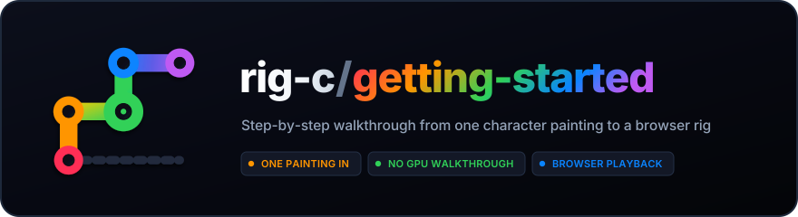

<p align="center">
  
</p>

# rig-c/getting-started

You start with one painting of a character. You end with that character rigged — split
into movable pieces on a skeleton — breathing, blinking and waving in your browser.


Under-eight-second looping WebP, from this walkthrough's outputs.
[Rebuild it](docs/demo/README.md). Example artwork: CC BY-NC 4.0; credit below.

## The whole thing in one glance

1. **Paint one character.** An image model does this. It wants a GPU, but any image
   generator you already use will do.
2. **Split it into layers, and mark the joints.** [See-through](https://github.com/shitagaki-lab/see-through)
   is a model that cuts a painting into layers (hair, face, eyes, clothes…) the way a PSD is
   layered. It wants a GPU too, or you use its free web demo. The joints — shoulders,
   elbows, knees and so on — come from a small script on the CPU, or your own hand.
3. **Run the four rig-c packages.** They turn the layers into a rig, give it a motion, and
   play it in a browser. **No GPU, ever.**

Only steps 1 and 2 want a GPU, and both have a no-GPU way. The four packages make neither
the painting nor the layers, and ship no model weights.

*Try it first* has been run on an Apple Silicon Mac and, for the latest published-package
refresh, on Linux with empty caches and the joint detector. The versions, setup, date and
timings are in [docs/REFERENCE.md](docs/REFERENCE.md) — if an output of yours differs in a
detail, look there first.

**Contents:** [Try it first](#try-it-first--no-gpu-about-3-minutes) ·
[Use what you made](#use-what-you-made) ·
[Make your own character](#make-your-own-character) ·
[Troubleshooting](#troubleshooting) · [Where to go next](#where-to-go-next) ·
[Credits and licences](#credits-and-licences)

## Try it first — no GPU, about 3 minutes

This builds a published example character and plays it. Its painting and layers are
already made, so you skip the GPU steps entirely.

**You'll need:** [Bun](https://bun.sh) 1.4.0 or later (`bun --version` prints it), and
[uv](https://docs.astral.sh/uv/) for the one Python script in step 6 — or skip the script;
step 6 says how. About 3 minutes of commands, plus the first-time downloads, under 1 GB in
all. The commands are for a macOS or Linux terminal; Windows isn't tested yet.

### 1. Install the packages

```sh
mkdir rig-c-start
cd rig-c-start
git clone https://github.com/rig-c/getting-started
mkdir my-rig
cd my-rig
bun add @rig-c/parts @rig-c/core @rig-c/pose @rig-c/play
```

The See-through commands below read `config.seethrough`, which needs
`@rig-c/parts` 1.82.1 or newer; this also covers step 7's `extend_painting` fields
`order` and `min_held_alpha`. Bun writes the exact installed versions to
`package.json` and `bun.lock` in `my-rig`; keep both files to reproduce the install.

Every command from here on runs in `my-rig`. `bun run rigc --version` prints the version and
then `@esotericsoftware/spine-core absent`. That line is expected: the installed `rigc`
checks every build with its own validator.

### 2. Get the example inputs

```sh
curl -L -o exam.tar.gz https://codeload.github.com/rig-c/exam/tar.gz/01436ee3f02c189fe1a1e9656fe62068889837f5
tar -xzf exam.tar.gz --strip-components=3 exam-01436ee3f02c189fe1a1e9656fe62068889837f5/tasks/01-build/inputs
tar -xzf exam.tar.gz --strip-components=1 exam-01436ee3f02c189fe1a1e9656fe62068889837f5/LICENSE exam-01436ee3f02c189fe1a1e9656fe62068889837f5/NOTICE.md
rm exam.tar.gz
bun ../getting-started/scripts/split-right-arm.ts inputs/layers/full
```

You should now have `inputs/` with `painting.png`, `layers/full/`, `layers/head/`,
`seethrough.json` and `generation.json`. The example is from
[rig-c/exam](https://github.com/rig-c/exam); its licence is under [Credits](#credits-and-licences).

### 3. Start the config

```sh
cat > config.json <<'EOF'
{
  "key": "exam-01",
  "seethrough": { "resolution": 1024, "steps": 30, "seed": 42, "offload": false },
  "assemble": { "rig_scale": 0.5 }
}
EOF
bunx rig-parts inputs --source inputs/painting.png --config config.json --out work
```

`config.json` is the one file the tools read about this character; it starts small and
fills in as you go. `rig_scale` 0.5 makes the rig half the painting's size.

You should see `st_input_full.png 2432x2432` and a note that there is no head box yet. With
your own painting, that square is what you feed See-through; here the layers are already in
`inputs/layers/full`.

### 4. Find the head box

The eyes are too small in the full-figure layers, so See-through runs a second time on a
crop around the head. This finds the crop.

```sh
bunx rig-parts layers inputs/layers/full
bunx rig-parts propose --head-box --full inputs/layers/full --canvas 1664x2432 | tail -n 1 > work/head_box.json
bun ../getting-started/scripts/take.ts work/head_box.json config.json seethrough.head_box=head_box
bunx rig-parts inputs --source inputs/painting.png --config config.json --out work
```

`--canvas` is the painting's width x height. [`scripts/take.ts`](scripts/take.ts) copies
fields the tools wrote into `config.json`, so you never move JSON by hand.

You should see `29 layer(s): 29 with opaque pixels` and `0 WARN line(s)`,
`work/head_box.json` reading `{"head_box":[616,32,1132,548]}`, then `st_input_head.png 516x516`
— the image for the head run, which here is already in `inputs/layers/head`.

### 5. Assemble the parts

```sh
bunx rig-parts assemble --propose-plan --source inputs/painting.png --full inputs/layers/full --head inputs/layers/head --config config.json > work/plan.json
bun ../getting-started/scripts/take.ts work/plan.json config.json assemble.plan=plan assemble.extend_below_crop=extend_below_crop
bunx rig-parts assemble --source inputs/painting.png --full inputs/layers/full --head inputs/layers/head --config config.json --out work
```

The plan says which layer becomes which part, and its `notes` say why any were left out.
About a minute.

You should see 22 parts, then `recomposite vs source: mean |d|=1.13, within 8: 97.8%`.
Open `work/render/recomposite_error_rig.png`: red is painting that no part holds. A few
small specks are normal; a large red area means a part is missing.

### 6. Find the joints

```sh
uv run --with rtmlib --with onnxruntime python ../getting-started/scripts/keypoints.py inputs/painting.png --out keypoints.json
```

The first run downloads two pose models (330 MB) and some Python packages (580 MB), about a
minute in all on a fast connection; after that it takes about 2 seconds. You should see
`18 observed, 0 occluded, 0 missing -> keypoints.json`.

No Python? [docs/KEYPOINTS.md](docs/KEYPOINTS.md) has a hand-placed set for this very
painting; save it as `keypoints.json`. Its left ankle is already where step 7's first line
puts it, and you get the same 44 bones. It was tuned to the script's joints, so the steps
print slightly different joint-dependent readings. The earlier body-root measurements used
this hand-placed set; the expected lines below now use the cold detector run.

### 7. Draft the bones

```sh
bun -e 'const f = "keypoints.json", k = await Bun.file(f).json(); k.people[0].joints.l_ankle.at = [848, 2140]; await Bun.write(f, JSON.stringify(k, null, 1) + "\n")'
bunx rig-parts propose --parts work/rig --source inputs/painting.png --out work --keypoints keypoints.json
bun ../getting-started/scripts/take.ts work/proposal.json config.json bones meshes regions motion limbs
bun -e 'const f = "config.json", c = await Bun.file(f).json(); delete c.regions["upperarm-r"]; c.limbs.arm_r.segments[0].from = "upperarm-r"; c.assemble.extend_painting = [{ part: "shin_l", band: [405, 1073, 444, 1098], max_distance: 15, min_held_alpha: 250, order: 0 }, { part: "foot_l", band: [440, 1092, 444, 1098], max_distance: 4, min_held_alpha: 250, order: 1 }]; await Bun.write(f, JSON.stringify(c, null, 2) + "\n")'
```

`propose` drafts the bones, the meshes and an idle motion; `take.ts` copies them into the
config. This is where a person corrects the draft, and the first line is the example's one
correction. The script puts the left ankle at `[855.7, 2154.1]`, 12 px off the leg's art,
and without the line `propose` says so: `LINT foot_l at [428, 1077], the l_ankle joint and
leg_l1's tip, lies on none of leg_l's art within 1 px along its joint line`, and the left
leg is drafted without its ankle cut, so the shoes stay one part that no leg bone moves.
Moved onto the shin at `[848, 2140]` (painting px), both ankles lie on the leg art and on
the shoes, and `propose` cuts the shoes between the feet, one part per foot under each
shin. A `LINT` is something to look at, not a refusal; this one is worth fixing because
step 9b's hello moves a foot.

You should see a note per joint, among them `and foot_r, shoes's share below the ankle, on
bone foot_r at the r_ankle joint under leg_r1` and the same for `foot_l`, then
`0 LINT line(s) over 6 mesh(es) and the hip` and a coverage line ending `44 bone(s) — 29
checked and clean, 0 checked with a LINT line, 15 not checked`. Open
`work/render/landmarks.png` to see the bones over the painting.

The last line assigns the example's missing ankle painting to the final `shin_l`
and `foot_l` parts. The half-open `band` rectangles use rig pixels, x right/y down;
`max_distance` bounds four-neighbour steps from each original silhouette. A
`min_held_alpha` of 250 admits original combined alpha-over coverage strictly below
250, including faint layer edges. Lower `order` values claim first: the shin
claims first, and its gains block the foot's later candidates and paths. Every
entry has a unique explicit order; array position supplies no priority. Only these
two declared parts gain the painting's RGBA inside their bounds; their own samples
at or above the floor and all other parts stay exact. These measured rectangles
are for this example, not coordinates to copy onto another painting.

### 8. Build the rig

```sh
bunx rig-parts build --config config.json --source inputs/painting.png --full inputs/layers/full --head inputs/layers/head --out out --loop
```

About a minute. You should see `limb cut: "shoes" opaque 13735 = "foot_r" 8071 + "foot_l"
5664`, the shoes cut in two, then `[check] check: PASS; 12 of 14 bar(s) measured, 2 skipped
(FEET_STAY_LEVEL, STRESS_OFF_CHAIN)`, then `build: PASS`. `FEET_STAY_LEVEL` is skipped
because the idle turns no leg; step 9b's hello does. Open `out/idle.gif`: the character breathes and blinks in a 3.3-second loop.
If any line says `FAIL`, nothing was written, and that line says what to change.

### 9. Give it a wave

[`@rig-c/pose`](https://github.com/rig-c/pose) moves a rig from joint positions over time —
from a video, a dataset, or, here, [`scripts/wave.ts`](scripts/wave.ts), which makes a
3-second wave from your keypoints. The map says which bones carry which joints, by the
names `propose` gave this rig.

```sh
bun ../getting-started/scripts/wave.ts keypoints.json wave.pose.json
bun run rig-pose clean --pose wave.pose.json --out wave.pose.clean.json
cat > map.json <<'EOF'
{
  "spec": "rig-pose-map/1",
  "chains": [
    { "name": "trunk", "bones": ["chest"], "joints": ["mid_hip", "neck"], "aim": ["neck"] },
    { "name": "arm_r", "bones": ["sleeve_r0", "sleeve_r1"], "joints": ["r_shoulder", "r_elbow", "r_wrist"], "bend": "free" },
    { "name": "arm_l", "bones": ["sleeve_l0", "sleeve_l1"], "joints": ["l_shoulder", "l_elbow", "l_wrist"], "bend": "free" }
  ],
  "translate": { "bone": "hip", "joint": "mid_hip", "scale": { "pose": ["mid_hip", "neck"], "rig": ["hip", "neck"] } }
}
EOF
bunx rig-pose retarget --rig out/rig --map map.json --pose wave.pose.clean.json --out wave.motion.json --name wave --profile rig-play --build wave-build
mkdir -p wave-rig
cp -R out/rig/. wave-rig/
cp wave.motion.json wave-rig/motion.json
bunx rig-parts check --rig wave-rig --parts out --out wave-check
```

You should see `73 frame(s), 3 s at 24 fps`, `GATE   rigc build --profile rig-play: green`, and
`FOLD   rigc render --folds at 24 fps: no mesh folds`, and
`wrote wave.motion.json — animations: idle, wave`. A `FOLD` line is a reading, not a
failure: where a mesh does fold, it names the part and the frames to look at.
`wave-build/` holds the rig with the new animation. The last four lines hand the same
motion to the parts checker too: retarget checks the compile and folds, while the parts
checker also reads the body-root seams. It should end `check: PASS`.

The upper arm stays under the armhole so the shoulder never opens as the forearm waves
(`--peak-degrees 180` by default; [the measurements](docs/REFERENCE.md#step-9-the-forearm-wave)).
The separate elbow opening is tracked in [#18](https://github.com/rig-c/getting-started/issues/18).

### 9b. Say hello

Before step 10, run [step 9b](docs/guide/motion.md#9b-say-hello) for the hello animation, then continue to step 9c.

### 9c. Let the hair and the skirt answer

After step 9b, run [step 9c](docs/guide/motion.md#9c-let-the-hair-and-the-skirt-answer) for hair and skirt physics, then continue to step 9d.

### 9d. Turn the head with depth

After step 9c, run [step 9d](docs/guide/depth-turn.md#9d-turn-the-head-with-depth) for the head turn, then return here for step 10.

### 10. Play it in your browser

<!-- try-it-ci: server -->
```sh
bun ../getting-started/scripts/serve.ts
```

Open <http://localhost:3000/?model=out/check/build/skeleton.model.json&anim=hello&under=idle>.

You should see her notice you — "hm?", her head straightening — then smile with narrowed
eyes and two little shrugs, wave with her forearm beside her shoulder, and re-plant her
weight, one foot sliding in toward the other and back, before it starts again. The locks beside her
face trail her head, and the skirt swings after her hip when she settles. `&under=idle` keeps the idle playing beneath, so she breathes
through it. The page also blows a light breeze, wind 0.75 + 0.25 × sin(2π × 0.2 t) to the right, one
slow gust every five seconds, through `@rig-c/play`'s `player.environment()`. The locks and the
skirt answer it only faintly — about a pixel at this size, so you will notice it more than see it swing:
any stronger wind opens the seam between the face and the front hair on the hello (see REFERENCE). Untick **breeze**, or add `&wind=0`, for the runtime's own steady
wind, [1, 0], and the body alone. The breeze belongs to the page, not to the rig: the build is the same
either way. Step 9's wave is at
<http://localhost:3000/?model=wave-build/skeleton.model.json&anim=wave>; the menu switches
animations. Ctrl+C stops the server. That's the whole chain. The page is
[`scripts/play.html`](scripts/play.html), about eighty lines around `@rig-c/play`;
[`scripts/serve.ts`](scripts/serve.ts) serves it on your own machine only.

## Use what you made

Play the rig on the web, in an engine adapter, the Spine editor, or a Spine runtime: [docs/guide/use-what-you-made.md](docs/guide/use-what-you-made.md).

## Make your own character

Make your own painting, layers and joints: [docs/guide/make-your-own-character.md](docs/guide/make-your-own-character.md).

### Route A: your own NVIDIA GPU

See [Route A](docs/guide/make-your-own-character.md#route-a-your-own-nvidia-gpu).

### Route C: no GPU at all

See [Route C](docs/guide/make-your-own-character.md#route-c-no-gpu-at-all).

### The joints

See [The joints](docs/guide/make-your-own-character.md#the-joints).

## Troubleshooting

Fixes for walkthrough, ComfyUI, web-demo and joint-script errors: [docs/guide/troubleshooting.md](docs/guide/troubleshooting.md).

## Where to go next

- **Look at the skeleton.** `bunx rigc inspect --candidate out/check/build --show art,bones --hide-bone '*_ctl' --max 1200 --out out/inspect.png`
  draws the bones over the setup pose;
  `bunx rigc render --candidate out/check/build --animation idle --out out/render` writes
  the idle's 41 frames and a contact sheet.
- **One command for all of it.** The [trailer](https://github.com/rig-c/trailer) repository
  rebuilds the rig-c trailer, a seated character on a swing, with one script.
- **The packages' own guides**: [`@rig-c/parts` AUTHORING.md](https://github.com/rig-c/parts/blob/main/docs/AUTHORING.md)
  (every config field, what each refusal means, expressions and physics),
  [`@rig-c/core`](https://github.com/rig-c/core#readme) (the compiler and its check),
  [`@rig-c/pose`](https://github.com/rig-c/pose#readme) (map and pose formats, keypoints from
  video), [`@rig-c/play`](https://github.com/rig-c/play#readme) (the player's API and cost).
- [docs/REFERENCE.md](docs/REFERENCE.md): tested-with versions, every measured time and
  size, each requirement's source, and what hasn't been measured yet.

## Credits and licences

This guide and its scripts are MIT ([LICENSE](LICENSE)).

The example inputs in *Try it first* belong to [rig-c/exam](https://github.com/rig-c/exam)
and are licensed CC BY-NC 4.0, not MIT: free to use with credit, not for commercial use.
`forearm-r.png` and `upperarm-r.png` in this repository derive from that painting, under the same licence.
Step 2 copies the exam's `LICENSE` and `NOTICE.md` beside them, and what you build from
them carries that licence. The exam's notice asks for this credit for the painting:

> *Painted with Nova Anime XL IL v8.0 by Crody (https://civitai.com/models/376130).*

For Spine terms, see the core [NOTICE](https://github.com/rig-c/core/blob/main/NOTICE.md). See-through's code and
models are not part of any rig-c package; their terms are collected in the parts
[NOTICE.md](https://github.com/rig-c/parts/blob/main/NOTICE.md). The model files in Route A
each carry their own licence, linked from [docs/REFERENCE.md](docs/REFERENCE.md#the-model-files-exactly).
