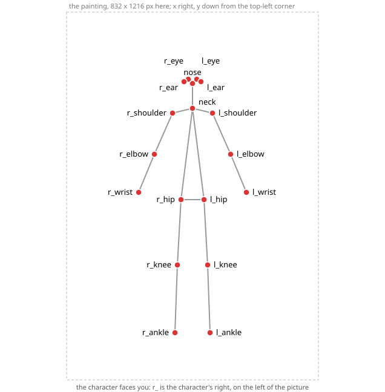

# The joints, by hand

`rig-parts propose --keypoints` reads a small JSON file that says where the character's 18
body joints are on the painting. [`scripts/keypoints.py`](../scripts/keypoints.py) writes
it for you; this page is for writing it yourself, and it holds a complete example for the
painting used in the README's *Try it first*.

## Where each joint goes

Open the painting in an image editor that shows the pointer's pixel position and read off
each joint, with x to the right and y down from the top-left corner. `r_` and `l_` are the
**character's** right and left: on a figure facing you, `r_shoulder` is on the left of the
picture.



The picture is drawn from the stick figure in [PAINTING-RECIPE.md](PAINTING-RECIPE.md),
the same 18 names on an 832 x 1216 canvas, not from any painting. Each dot goes where the
joint turns: the shoulder at the top of the arm where it meets the body, the elbow and the
knee at the bend, the wrist and the ankle at the end of the limb, the hips at the top of
each thigh, the eyes at their centres, the ears where they meet the head. The same points,
as text:

```
              r_eye  l_eye
       r_ear     nose      l_ear
                 neck
     r_shoulder        l_shoulder
    r_elbow                l_elbow
  r_wrist       r_hip  l_hip     l_wrist
                r_knee l_knee
               r_ankle l_ankle
```

The neck is the midpoint of the two shoulders.

## The file

`width` and `height` are the painting's size in pixels. A joint you can see is `observed`;
one hidden under clothes or hair is `occluded`, with your best estimate; one you cannot
place at all is `missing`, with no `at`. Every `at` must lie inside the painting.

This is a hand-placed set for the example painting (1664 x 2432). Save it as
`keypoints.json` in `my-rig` to use it in place of the script's output:

```json
{
  "spec": "spine-parts-keypoints/1",
  "space": { "units": "painting-px", "origin": "top-left", "y": "down" },
  "width": 1664, "height": 2432,
  "source": "placed by hand",
  "people": [
    { "id": "a", "joints": {
        "nose":       { "state": "observed", "at": [891, 332] },
        "neck":       { "state": "observed", "at": [877, 541] },
        "r_shoulder": { "state": "occluded", "at": [720, 532] },
        "r_elbow":    { "state": "observed", "at": [672, 835] },
        "r_wrist":    { "state": "observed", "at": [560, 1136] },
        "l_shoulder": { "state": "occluded", "at": [1034, 550] },
        "l_elbow":    { "state": "observed", "at": [1098, 835] },
        "l_wrist":    { "state": "observed", "at": [1228, 1107] },
        "r_hip":      { "state": "occluded", "at": [779, 994] },
        "r_knee":     { "state": "observed", "at": [637, 1657] },
        "r_ankle":    { "state": "observed", "at": [447, 2148] },
        "l_hip":      { "state": "occluded", "at": [1010, 1000] },
        "l_knee":     { "state": "observed", "at": [944, 1669] },
        "l_ankle":    { "state": "observed", "at": [848, 2140] },
        "r_eye":      { "state": "observed", "at": [832, 272] },
        "l_eye":      { "state": "observed", "at": [950, 284] },
        "r_ear":      { "state": "missing" },
        "l_ear":      { "state": "missing" } } }
  ]
}
```

With this set, the example rig comes out with 44 bones: a chain per leg, and the shoes cut
into one part per foot under each shin, the same as the script's joints give once the
README's step 7 has moved their left ankle. The feet are cut only when each ankle lies on
its leg's art and on the shoes; `l_ankle` sits at `[848, 2140]` for that, and the README's
step 7 line puts it there whichever set you use. Earlier versions of the parts package gave
other counts; [REFERENCE.md](REFERENCE.md#the-leg-chain-moves-with-the-joints) keeps them.

The set was tuned to land where the script's joints do: each joint here is within a pixel
of what `scripts/keypoints.py` writes for this painting, and the ears, which it places,
are left `missing`. The hips, the knees and the right ankle are the ones that matter. An
earlier set had them 14–50 px off, and the right leg's stance came out 0.7 degrees wider:
the README's step 9b hello then slid the right foot 41.1 px instead of 33.2 and opened a
seam at the right knee. With this set step 9b prints `right ankle 33.6 px in (40 % of the
way to parallel, 16.05 -> 12.92 deg)`, and every other line the README quotes as written.

## What the script writes

`scripts/keypoints.py` runs RTMPose (whole-body, "balanced") through
[rtmlib](https://github.com/Tau-J/rtmlib) and onnxruntime on the CPU, keeps the most
confident person, and writes the same file. Joints the model scores below 0.3 are written
`occluded`, with the model's position as an estimate; joints it puts outside the picture
are written `missing`. The neck is the midpoint of the shoulders, scored the lower of the
two, since the model has no neck point. With several people in the picture it keeps the one
with the highest mean body score and says so. Its times and downloads are in
[REFERENCE.md](REFERENCE.md#the-joint-script-scriptskeypointspy).
